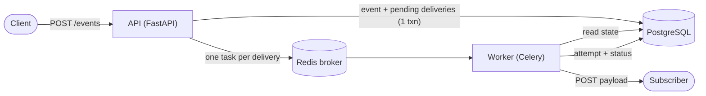

# Webhook Relay

An asynchronous webhook relay. Subscribers register for event types; when a matching event comes in, it's delivered to each of them over HTTP, in the background, with retries and a full record of every attempt.

## How it works

A client registers subscriptions — a target URL paired with an event type. When an event is posted, it fans out to every active subscription that matches, and each match becomes an independent delivery that the system keeps trying to complete on its own.

The flow for a single event:

1. `POST /events` stores the event and, in one transaction, creates a `pending` delivery for each active subscription matching the event type.
2. Once that transaction commits, one background task is enqueued per delivery. (Enqueueing happens after the commit so a broker hiccup can never leave the database and the queue disagreeing about what exists.)
3. The worker picks up a delivery, marks it `processing`, and commits that before making the outbound call — so a crash mid-request is still visible in the database afterwards.
4. It POSTs the event payload to the subscriber's URL. A `2xx` response marks the delivery `success`; anything else (an error status, a timeout, a connection failure) counts as a failed attempt.
5. Failed deliveries are retried up to 3 times (4 attempts in total) with a fixed delay. Once those are exhausted, the delivery is marked `failed`.
6. Every attempt — success or failure — is written as its own row, so each delivery carries a complete history of what was tried and what came back.

Delivery status lives in PostgreSQL, which is the source of truth; the task queue keeps no results of its own. Delivery is at-least-once: after a retry a subscriber can receive the same event twice, so receivers should expect duplicates, but deliveries are never silently dropped. Exactly-once isn't promised, since it can't be guaranteed over an unreliable network. The worker also guards against re-processing a delivery that's already finished, so a redelivered queue message doesn't cause a double-send.



A delivery goes `pending` → `processing` → `success`, or `failed` once retries are exhausted. If the subscription is inactive when the worker reaches it, the delivery is `skipped` with no HTTP call. Deactivating a subscription flips a flag rather than deleting anything, so the events, deliveries, and attempts tables together stay a complete audit log of everything the service has seen and done.

## Data model

Four tables, managed through Alembic migrations:

- **`subscriptions`** — `target_url`, `event_type`, `active`, `created_at`. A URL can subscribe to a given event type only once (a unique constraint enforces it).
- **`events`** — `event_type`, `payload` (stored as JSONB), `created_at`.
- **`deliveries`** — links one event to one subscription, with `status`, `attempt_count`, and `created_at`. One delivery per event/subscription pair.
- **`delivery_attempts`** — one row per outbound HTTP attempt: when it happened, the response status if any, and the error type on failure.

## Validation and safety

- Request bodies are size-limited (oversized requests are rejected with `413` before they're read into memory).
- Input is validated at the edge: malformed target URLs, non-object payloads, and values PostgreSQL's JSONB can't store are rejected before anything reaches the database.
- The application's own logs record hostnames and internal IDs only — never full target URLs (which can carry secrets) or event payloads.

## Stack

- Python, managed with uv
- FastAPI
- Celery with a Redis broker (no result backend)
- PostgreSQL with SQLAlchemy and Alembic
- httpx for outbound calls
- Docker Compose — `api`, `worker`, `postgres`, `redis`, and a dev-only `receiver`, with the app services sharing one image

## Running it

```bash
cp .env.example .env            # then fill in the values
docker compose up --build
docker compose exec api alembic upgrade head
```

Configuration is read from environment variables; see `.env.example` for the full list. Secrets stay out of version control — `.env` is git-ignored.

Interactive API docs are served at `http://localhost:8000/docs`.

## API

- `GET /health` — readiness check (hits the database, not just the process)
- `POST /subscriptions` — register a subscription
- `GET /subscriptions` — list subscriptions
- `PATCH /subscriptions/{id}` — deactivate a subscription
- `POST /events` — ingest an event and fan it out
- `GET /events/{event_id}` — fetch one event
- `GET /deliveries` — list deliveries (filter by `subscription_id` and `status`; paginated with `limit`/`offset`)

```bash
# register a subscription
curl -X POST http://localhost:8000/subscriptions \
  -H "Content-Type: application/json" \
  -d '{"target_url": "https://example.com/hook", "event_type": "order.created"}'

# send an event — the response contains the IDs of the deliveries it created
curl -X POST http://localhost:8000/events \
  -H "Content-Type: application/json" \
  -d '{"event_type": "order.created", "payload": {"order_id": 42}}'

# inspect what was delivered
curl "http://localhost:8000/deliveries?status=success"
```

## Tests

The suite runs on the host against the Compose PostgreSQL instance — the runtime image is built without dev dependencies, so `pytest` isn't installed inside it. Redis isn't needed: task enqueueing is faked, and the outbound HTTP call is mocked, so the tests depend on neither the broker, the network, nor a live receiver.

```bash
# create the test database once (Postgres only runs its init on an empty volume)
docker compose exec postgres createdb -U <user> webhook_relay_test

# set TEST_DATABASE_URL in .env: host "localhost", the published port, and a
# database name ending in "_test" (both are enforced by a guard in the tests).

uv run --env-file .env pytest
```

The tests cover schema validation, the fan-out logic and its error paths against real PostgreSQL, and the delivery task (with the HTTP call mocked out).

## Not included yet

Planned for a second version:

- **Authentication** on the API — as it stands, anyone who can reach it can register subscriptions and post events.
- **SSRF protection** on outbound calls — restricting target URLs so the worker can't be pointed at internal hosts.
- **HMAC request signing**, so subscribers can verify a payload really came from the relay.
- **A dead-letter queue** for deliveries that exhaust their retries — a prerequisite for safely requeueing a delivery when a worker dies mid-task.
- **Exponential backoff** with jitter, replacing the current fixed retry delay.
- **Outbound connection pooling** — a shared httpx client, created per worker process to stay safe under Celery's prefork model.
- **Continuous integration** running the test suite against a PostgreSQL service container.
- **A package reorganisation** separating the shared core from the API and worker entry points.

The full list of accepted limitations, with rationale, is in [`KNOWN_LIMITATIONS.md`](./KNOWN_LIMITATIONS.md).

## License

MIT — see [`LICENSE`](./LICENSE).